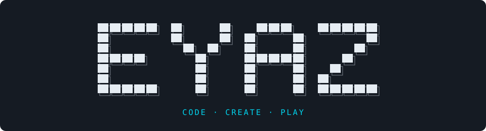

<p align="center">
  
</p>

<p align="center"><strong>Web Development &nbsp; | &nbsp; Browser Games &nbsp; | &nbsp; Creative Projects</strong></p>

<p align="center">
<a href="https://github.com/eyazcod?tab=repositories"></a>
<a href="https://github.com/eyazcod/eyaz-game"></a>
</p>

---

## About Me

```yaml
name: EYAZ
github: eyazcod
interests:
  - Web development
  - Browser games
  - Pixel art and interactive experiences
featured_project: eyaz-game
```

أهلًا، أنا إياز 👋  
هنا أشارك مشاريعي وتجاربي البرمجية، ومنها **إياز** — لعبة منصات بكسل تعمل مباشرة في المتصفح.

## Featured Project

### 🎮 [إياز — Eyaz Game](https://github.com/eyazcod/eyaz-game)

A pixel platformer that runs in your browser.

- **Play your way:** keyboard, mouse, touch, and standard gamepads.
- **Make it yours:** customizable controls.
- **Pick up where you left off:** progress and settings saved locally.

[**Explore the source →**](https://github.com/eyazcod/eyaz-game)

---

<p align="center">
<a href="https://github.com/eyazcod?tab=repositories">Explore my projects</a> &nbsp; · &nbsp; <a href="https://github.com/eyazcod/eyaz-game/issues">Eyaz Game — feedback & ideas</a>
</p>
